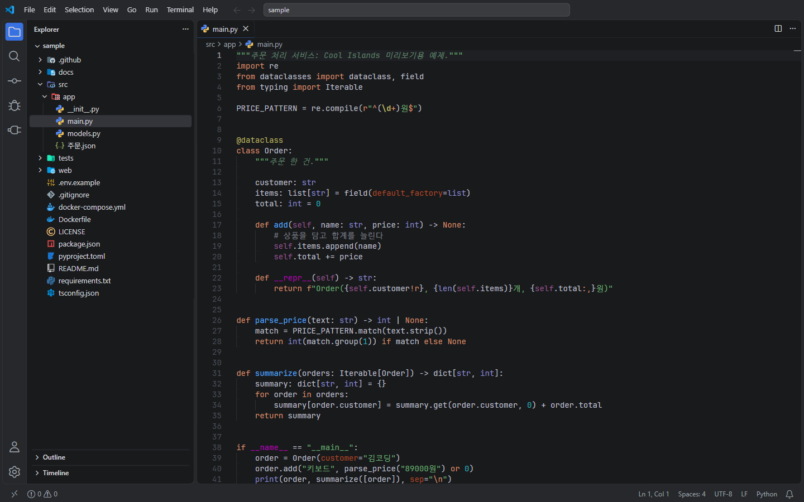
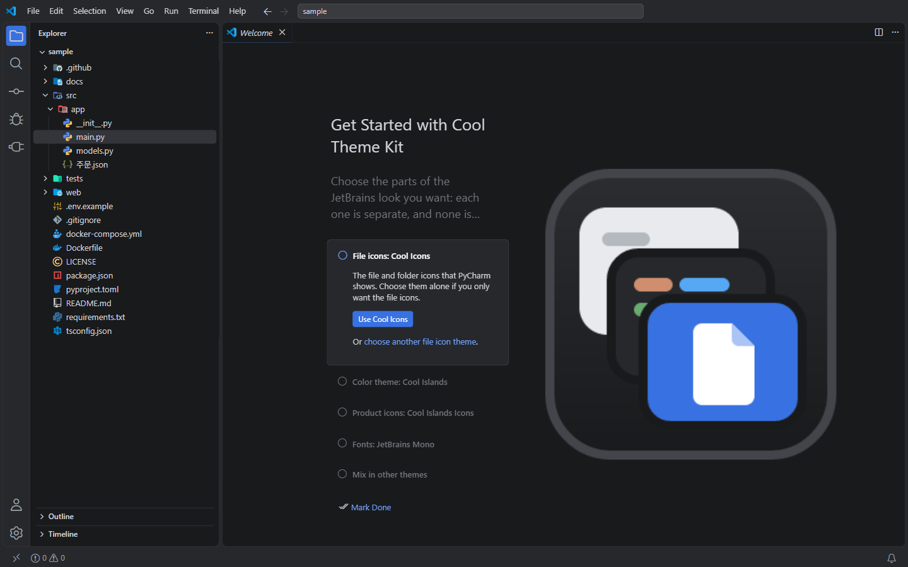
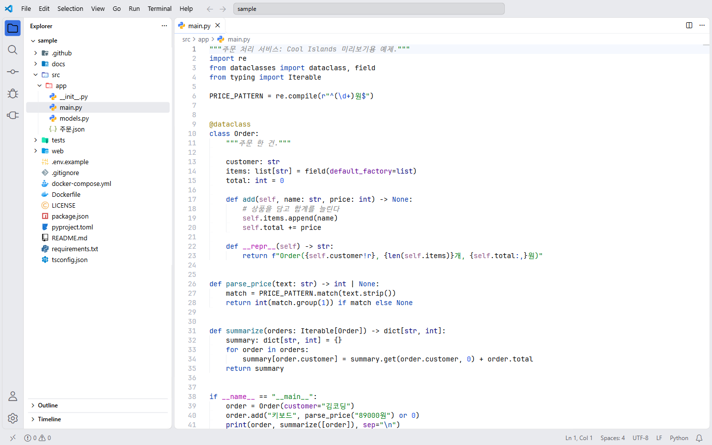
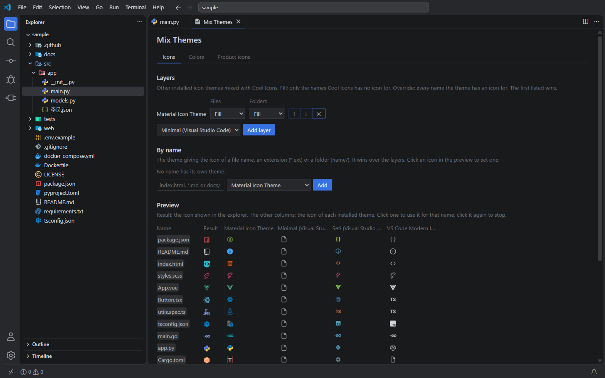
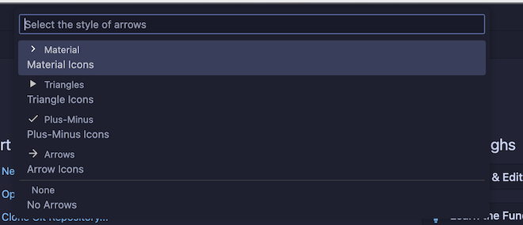
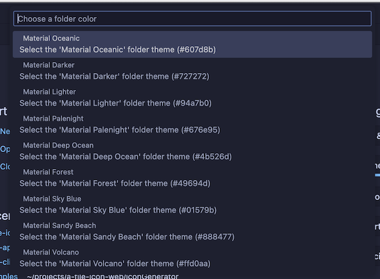
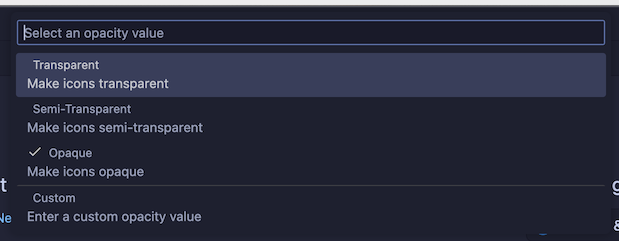
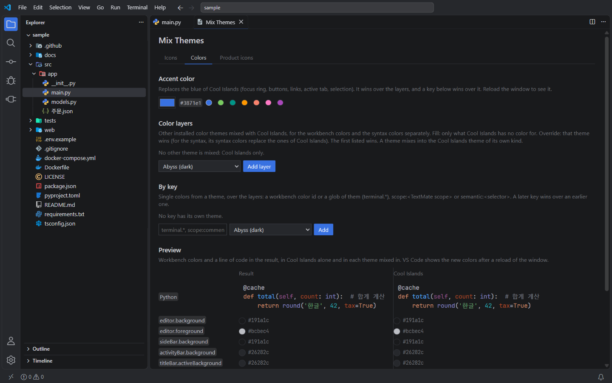
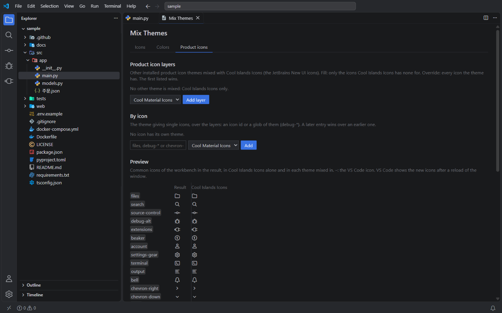
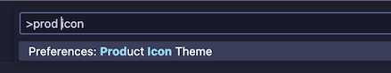

<h1 align="center">
  
  <br>
  Cool Theme Kit for VS Code
</h1>

<p align="center">
  The look of PyCharm and the other JetBrains IDEs (New UI, Islands themes) for VS Code:<br>
  file icons, color themes, product icons and fonts, each one optional, with your other themes mixed in.
</p>



- **Made for people coming from PyCharm or IntelliJ IDEA.** The file icons are the ones PyCharm shows with the Atom
  Material Icons plugin, and the colors and icons are generated from the JetBrains sources, not drawn by hand.
- **Take only what you want.** Installing the extension changes nothing: choose the file icons, the colors, the product
  icons and the fonts one by one. A user of the file icons alone keeps their own colors and font.
- **Keep your other themes.** VS Code uses one theme of each kind; Cool Theme Kit mixes other installed themes into its
  own, by priority and with exceptions, on a page with a preview (no JSON to write).
- **Korean first.** The interface and settings are translated, Korean file names are matched in any Unicode form, and
  the fonts put D2Coding and the Korean system fonts behind JetBrains Mono, so Hangul stays aligned.

## Getting started

1. Install **Cool Theme Kit**. The **Get Started with Cool Theme Kit** walkthrough opens on the Welcome page (or run
   **Welcome: Open Walkthrough...**).
2. Click the parts you want. Each button applies one part only:



You can also select the themes with **Preferences: File Icon Theme**, **Preferences: Color Theme** and **Preferences:
Product Icon Theme**, and the fonts with the **Use the JetBrains Fonts** command. Everything is undone the same way:
select another theme, or run **Stop Using the JetBrains Fonts**.

| Cool Islands Light                                                    | Mix Themes page                                                   |
|-----------------------------------------------------------------------|-------------------------------------------------------------------|
|         |       |

What VS Code itself cannot do (rounded floating panels, the interface font, colored product icons) is listed in
[Differences with the JetBrains plugin](#differences-with-the-jetbrains-plugin) and [Compatibility](#compatibility).

## Themes

| Kind          | Name in the VS Code picker              | Base                                               | Status                                                                               |
|---------------|-----------------------------------------|----------------------------------------------------|--------------------------------------------------------------------------------------|
| File icons    | **Cool Icons**                          | Atom Material Icons, as PyCharm shows them         | Available, with other icon themes [mixed in](#mixing-icon-themes)                    |
| Color theme   | **Cool Islands Dark / Light**           | JetBrains Islands Dark / Light                     | [Available](#color-themes), with other color themes [mixed in](#mixing-color-themes) |
| Product icons | **Cool Islands Icons**                  | JetBrains New UI icons                             | [Available](#product-theme), with other product icon themes [mixed in](#mixing-product-icon-themes) |
| Product icons | **Cool Material Icons**                 | Material Design Icons, from the original extension | Available                                                                            |
| Fonts         | **Use the JetBrains Fonts** command     | JetBrains Mono, then Korean fallbacks              | [Available](#fonts-and-korean), when you choose them                                 |

Cool Theme Kit is an unofficial fork of [Atom Material Icons](https://github.com/AtomMaterialUI/a-file-icon-vscode), a port
of the [Atom File Icons](https://github.com/file-icons/atom) for VS Code, inspired by the
[Material Icon Theme](https://github.com/PKief/vscode-material-icon-theme) and
[Atom Material Icons for JetBrains](https://github.com/mallowigi/a-file-icon-idea).

## Color themes

**Cool Islands Dark** and **Cool Islands Light** are the Islands Dark and Islands Light themes of the JetBrains IDEs
with the New UI: the colors of the windows, tool windows, tabs, lists and popups, and the
editor color scheme with the colors PyCharm adds for Python, Markdown, YAML and shell scripts, and the colors of the
scheme for HTML and XML tags, regular expressions, properties files and JavaScript/TypeScript (regex literals, members
and the globals of the standard library). Other languages get the default colors of the scheme (keywords, strings,
functions…), which is also what the JetBrains IDEs fall back to.

They are generated from the theme files of [JetBrains/intellij-community](https://github.com/JetBrains/intellij-community)
the way the IDE reads them (parent themes, named colors, `*` keys, parent schemes, inherited attributes), with a map of
which JetBrains color each VS Code color takes:

- Python looks like PyCharm: keywords, `self`, keyword arguments, builtins, `__dunder__` names, decorators and
  docstrings have their PyCharm colors, and constants, attributes and method calls keep the text color, as in PyCharm.
- With a language server (Pylance, TypeScript…), its semantic tokens get the same colors.
- Bracket pairs keep the text color: the JetBrains IDEs do not color them. Turn
  `editor.bracketPairColorization.enabled` off to remove the VS Code setting itself.
- VS Code cannot draw the rounded islands: the panels get the island color and the space between them the window color.

### Mixing color themes

VS Code uses a single color theme at a time. Other installed color themes can be mixed into Cool Islands, without
selecting them, for the workbench colors (`ui`) and the syntax colors (`syntax`) separately. Each one is a layer, given
by its id (the value of `workbench.colorTheme` when it is selected):

```json
{
  "a-file-icon-vscode.colorThemeLayers": [
    { "theme": "GitHub Dark", "ui": "off", "syntax": "override" },
    "Monokai"
  ]
}
```

- `fill` (a plain id is `fill` for both): only what Cool Islands has no color for (the colors of other extensions, the
  scopes it has no rule for);
- `override`: the workbench colors of the theme win; for the syntax, its token and semantic colors replace the ones of
  Cool Islands;
- `off`: not used.

A theme mixes into the Cool Islands theme of its own kind: a dark theme into Cool Islands Dark, a light one into Cool
Islands Light. `"applyTo": "dark" | "light" | "both"` changes that.

`colorThemeByKey` takes single colors from a theme, over every layer: a workbench color id or a glob of them, a TextMate
scope (`scope:`) or a semantic token selector (`semantic:`). A later key wins over an earlier one:

```json
{
  "a-file-icon-vscode.colorThemeByKey": {
    "terminal.ansi*": "Dark Modern",
    "scope:comment": "Monokai",
    "semantic:parameter": "GitHub Dark"
  }
}
```

From the strongest to the weakest: `colorThemeByKey` > `accentColor` > the `override` layers (the first listed wins) > Cool Islands > the
`fill` layers (the first listed wins). The theme files are read the way VS Code reads them (comments, `include`, token
colors in another file); TextMate `.tmTheme` files are not read.

### Accent color

`accentColor` replaces the blue of the JetBrains Islands themes (`#3871e1`) in Cool Islands Dark and Light, for example
to match the green accent of a Material Theme UI setup in PyCharm. Leave it empty for the Islands blue:

```json
{
  "a-file-icon-vscode.accentColor": "#79cb60"
}
```

It changes the focus ring, buttons, the progress bar, links, the badge on the activity bar, the active tab, and the
selection of lists, menus and the editor. The pale selection of the light theme and the dark navy of the dark one keep
their lightness, so they stay readable: only their hue (and the saturation, by the same ratio) follows the accent, and
the text on a button or badge turns black or white when the accent would make it hard to read. Colors that only happen
to be blue but mean something else (git decorations, the terminal's blue, the debugger's stack frame, find matches)
are not touched.

The accent wins over the `colorThemeLayers` and loses to `colorThemeByKey`. The Colors tab of the
[Mix Themes page](#mix-themes-page) has a color picker with a few swatches. Like the rest of the color mixing, it
needs a window reload, and it works in the desktop app only (VS Code for the Web has the built-in colors).

VS Code reads a color theme again only when the window reloads: when the mixed colors of the selected Cool Islands
theme change, a notification offers to reload the window. The **Mix Color Themes (with Preview)** command opens the
[Mix Themes page](#mix-themes-page) on its Colors tab.

## Fonts and Korean

Cool Theme Kit changes no font by itself. The **Use the JetBrains Fonts** command (also a button of the walkthrough)
writes the fonts of the JetBrains IDEs to your user settings, after asking before it replaces a font you set there;
**Stop Using the JetBrains Fonts** removes them again (only these lists, never a font of your own). When you select a
Cool Islands color theme and have no editor font of your own, a notification offers them, once.

| Setting                       | Written by **Use the JetBrains Fonts**                                                                            |
|-------------------------------|-------------------------------------------------------------------------------------------------------------------|
| `editor.fontFamily`           | `'JetBrains Mono', 'D2Coding', Consolas, Menlo, 'Droid Sans Mono', 'Malgun Gothic', 'Apple SD Gothic Neo', 'Noto Sans Mono CJK KR', 'Courier New', monospace` |
| `markdown.preview.fontFamily` | `Inter, -apple-system, BlinkMacSystemFont, 'Segoe WPC', 'Segoe UI', system-ui, 'Malgun Gothic', 'Apple SD Gothic Neo', 'Noto Sans KR', Ubuntu, 'Droid Sans', sans-serif` |

- VS Code draws each character with the first font of the list that has it: the Korean fonts after JetBrains Mono and
  Inter draw the Hangul they do not have. D2Coding comes first among them because its Hangul is exactly two columns
  wide, so Korean text stays aligned.
- The terminal, the debug console, the inlay hints and the code lens use the editor font, as VS Code does by default.
- An extension cannot install fonts: when the editor uses these fonts and JetBrains Mono is missing (and D2Coding, with
  a Korean interface), a notification links to their download pages, once (`a-file-icon-vscode.showFontMessage` turns
  it and the offer off).
- An extension cannot change the font of the VS Code interface (menus, side bar, tabs) either: it stays the font of the
  system, with Malgun Gothic or Apple SD Gothic Neo for Korean.

Korean is checked in every part: the interface and the settings are translated (a test keeps the translation complete),
Korean file and folder names in your associations match in any Unicode form (macOS gives decomposed names), and the
Mix Themes page breaks Korean lines between words.

## File icon features

- Replaces **file icons** with their relevant logo icons
    - According to their extension (`.java`, `.php`, `.ruby`...)
    - According to the framework (Android, NPM, RSpec...)
    - According to the program used in conjonction (Babel, Docker, CircleCI...)
    - According to the parent directory (`.github/*`, `.vscode/*`...)
    - And others...
- Replaces **folder icons**:
    - From common patterns: `src`, `main`, `app`, `img`, `docs`...
    - From specific use cases: `node_modules`, `.vscode`, `.git.`..
- Mixes in **other installed icon themes** for the names you choose, or for the names it has no icon for.

## Associations

The icons follow what PyCharm shows with the [Atom Material Icons plugin for JetBrains IDEs](https://github.com/AtomMaterialUI/a-file-icon-idea):
for every file and folder name the JetBrains plugin knows and VS Code can express (a file name, an extension, a folder
name), the theme uses the icon the JetBrains plugin picks. Names the JetBrains plugin does not know keep the icons of
this extension.

You can find a list of all the available associations in the following links:

- [File Associations](https://material-theme.com/docs/reference/associations/)
- [Folder Associations](https://material-theme.com/docs/reference/folder-associations/)
- Language Associations: [`src/icons/languageIcons.ts`](./src/icons/languageIcons.ts) (VS Code language ids, used when no file
  name or extension matches)

## File Icons


## Folder Icons


---- 

## Usage

Since this extension is based off the
original [Material Icon Theme](https://github.com/PKief/vscode-material-icon-theme),
you can find most of the original settings here as well.

Therefore, this extension exposes a bunch of commands that you can invoke via the command palette:


Just type `Cool Theme Kit` in order to see the commands that are available.

----

## Settings

You can customize many aspects of the extension, either via the VSCode settings or by invoking the commands via the
command palette.

When setting the option via the _Preferences_, they will affect **all projects**, whereas the commands only
affect the **current workspace**.

---

### Icon Packs

While this extension contains a lot of icons, there are some icons that overlap with each other. For example, _Angular_,
and _NestJS_ use similar icon filename patterns. If you are working with an angular project you wouldn't want to see
NestJS icons and vice-versa.

This command will allow you to decide which pack(s) to enable for the current workspace.

By default the packs of the JetBrains plugin are enabled (Angular 2, Nest, Next, NgRx, Rails, Recoil, Redux, Tests), plus
`pycharm`. AngularJS (`angular`) is disabled, as in the JetBrains plugin.

As in the JetBrains plugin, two packs do not belong to a framework:

- **tests** (enabled by default): `*.test.ts`, `*.spec.py`... use the test icon of their language.
- **css** (disabled by default): `.css` files use the alternative CSS icon. It is enabled in the JetBrains plugin, but
  its icon loses against the regular CSS icon there, so PyCharm shows the regular one.
- **pycharm** (enabled by default): Python files look like in PyCharm. Every `.py`, `.pyi` and `.pyw` file, whatever its
  name (`manage.py`, `__init__.py`, `test_app.py`...), uses the two-tone Python icon of PyCharm instead of the Atom icons.


> **Note**: Since you can enable multiple packs, there is still a way to enable both overlapping icon packs. It's
> recommended to not do as such as it would return unexpected results.

---

### Arrow Styles

You can customize the look of the arrows in the tree view using the command palette:



or via user settings:

```json
{
  "a-file-icon-vscode.arrowTheme": "material"
}
```

The available options are:

- `material`: Material Design arrows (chevrons)
- `triangle`: Triangle arrows
- `plusMinus`: Plus and minus signs
- `arrow`: Simple Arrows
- `none`: No arrows

> Note: This setting affects not only arrows from the tree view, but also arrows that you can find in many other places,
> such as the collapsible sections, code folding, etc.

> Another note: Arrows in the tree view work differently than arrows in the other places, as they are currently rotated
> from
> the "down arrow". As a result, some styles will display "weird results", such as the "Plus-Minus" style, that only
> displays the minus sign, but rotated. This could be solved via custom CSS in the future.

---

### Custom Folder Color

You can customize the color of the default folder icon using the command palette:



or via user settings:

```json
{
  "a-file-icon-vscode.folderColor": "#ef5350"
}

```

----

### Folder Theme

You can change the style of the folder icons using the command palette:


or via user settings:

```json
{
  "a-file-icon-vscode.folderTheme": "specific"
}
```

The available options are:

- `specific`: Replace specific folders, such as `src`, `main`, `app`, `img`, `docs`, etc.
- `classic`: Replace all folders with the default folder icon
- `none`: No folder icons

----

#### Custom icons' opacity

You can customize the opacity of the icons, between totally opaque to completely gone.

You can either choose a predefined opacity or enter your own opacity via the command palette:



or via user settings:

```json
{
  "a-file-icon-vscode.opacity": 0.5
}
```

---

## Custom icons' saturation

You can customize the saturation of the icons. The less saturated they are, the more grayscale they will appear.

You can either choose a predefined saturation or enter your own saturation via the command palette:


or via user settings:

```json
{
  "a-file-icon-vscode.saturation": 0.5
}
```

## Monochrome icons

Display every file and folder icon in shades of a single color, like the _Monochrome icons_ option of the JetBrains
plugin. Use the **Toggle Monochrome Icons** and **Change Monochrome Color** commands, or the settings:

```json
{
  "a-file-icon-vscode.monochrome": true,
  "a-file-icon-vscode.monochromeColor": "#90a4ae"
}
```

## Hide file icons

Remove the file icons and keep the folder icons (`"a-file-icon-vscode.folderTheme": "none"` does the opposite):

```json
{
  "a-file-icon-vscode.hideFileIcons": true
}
```

## Mixing icon themes

VS Code uses a single file icon theme at a time. This theme follows the JetBrains plugin, which focuses on the languages
of the JetBrains IDEs: the files and folders it does not know get the default icon. Other installed icon themes can be
mixed in, without selecting them as the icon theme. Each one is a layer, given by its id (the value of
`workbench.iconTheme` when it is selected):

```json
{
  "a-file-icon-vscode.iconThemeLayers": [
    "material-icon-theme",
    { "theme": "vscode-icons", "files": "override", "folders": "off" }
  ]
}
```

A layer mixes in one of three ways, for files and for folders separately (a plain id is `fill` for both):

- `fill`: only for the names left with the default file or folder icon;
- `override`: its icon wins for every name it gives an icon to, and its default file or folder icon too;
- `off`: not used.

From the strongest to the weakest:

1. `iconThemeByName` (below);
2. the `override` layers, the first listed wins. Your own `filesAssociations`, `languagesAssociations` and
   `foldersAssociations` keep their icon;
3. this theme;
4. the `fill` layers, the first listed wins.

The default is `["material-icon-theme"]`: install the
[Material Icon Theme](https://marketplace.visualstudio.com/items?itemName=PKief.material-icon-theme) and its icons fill
the gaps. An empty list uses this theme only.

### One name from another theme

`iconThemeByName` gives a file name, an extension (`*.ext`) or a folder name (ending with `/`) the icon another installed
theme shows for it, or that theme's default icon when it has none. It wins over everything else:

```json
{
  "a-file-icon-vscode.iconThemeByName": {
    "*.svelte": "material-icon-theme",
    "package.json": "vscode-icons",
    "src/": "material-icon-theme"
  }
}
```

Like `*.ext` in `filesAssociations`, an extension does not replace the icon of the specific file names this theme knows
with that extension.

The icons of the other themes get the opacity, saturation and monochrome filters of this theme, and are updated when
those themes or their settings change. Folders only come from other themes with the `specific` folder theme, and files
not at all with `hideFileIcons`.

Themes made of font glyphs, like the built-in Seti theme (`vs-seti`), can be mixed in too: their glyphs come with their
font, and their colors get the saturation and monochrome filters. The opacity does not apply to them, since VS Code
takes no transparency in the color of a glyph. PNG icons are skipped.

Themes drawn with the color of the text (`usesCurrentColor`, like the built-in VS Code Modern theme) get the text color
of the default dark themes (`#cccccc`), and of the default light themes (`#3b3b3b`) in light color themes: VS Code only
paints the icons of the selected theme with the text color.

### Mix Themes page

The **Mix Themes (with Preview)** command opens a page to edit the layer settings without writing json, with a tab for
the icons, one for the colors and one for the product icons.

| Colors                                                                   | Product icons                                                                    |
|--------------------------------------------------------------------------|----------------------------------------------------------------------------------|
|                  |            |

- **Icons**: add, order and remove the layers and choose their mode for files and folders, and give single names their
  own theme. Its preview lists sample names (the default ones, the files and folders at the top of the workspace, or
  your own) with the icon of the result and the icon of each installed theme. Click the icon of a theme to use it for
  that name (`iconThemeByName`), click it again to stop.
- **Colors** (also **Mix Color Themes (with Preview)**): add, order and remove the color layers, choose their mode for
  the workbench and the syntax and the Cool Islands theme they mix into, and give single keys their own theme. Its
  preview shows workbench colors and a line of Python with Korean text in the result, in Cool Islands alone and in each
  theme mixed in.
- **Product icons**: add, order and remove the product icon layers and give single icons their own theme, with a
  preview of common workbench icons in the result, in Cool Islands Icons alone and in each theme mixed in.

----

## Product Theme

Two product icon themes replace the icons of the VS Code interface (**Preferences: Product Icon Theme**):

- **Cool Islands Icons**: the icons of the JetBrains New UI, as PyCharm shows them: the tool window buttons (Project,
  Find, Commit, Debug, Plugins…), the arrows of the trees, the editor and panel actions, find options, problems,
  run and debug, source control, and the symbols of the outline. The icons VS Code has no New UI equivalent for keep
  the VS Code icon. The font is built from the New UI SVGs of
  [JetBrains/intellij-community](https://github.com/JetBrains/intellij-community) (`bun run build:product-icons`): each
  icon is turned into a one-color glyph, as VS Code draws product icons with the color of the theme.
- **Cool Material Icons**: the Material Design Icons of the original extension. Its arrows follow the
  [arrow style](#arrow-styles) setting.

### Mixing product icon themes

Other installed product icon themes can be mixed into Cool Islands Icons, given by their id (the value of
`workbench.productIconTheme`), Cool Material Icons included:

```json
{
  "a-file-icon-vscode.productIconThemeLayers": [
    "a-file-icon-vscode-product-icon-theme",
    { "theme": "fluent-icons", "mode": "override" }
  ],
  "a-file-icon-vscode.productIconByName": {
    "debug-*": "fluent-icons"
  }
}
```

A layer is `fill` (a plain id: only the icons Cool Islands Icons has none for), `override` (every icon the theme has) or
`off`. `productIconByName` gives icon ids, or globs of them, the icon of a theme. From the strongest to the weakest:
`productIconByName` > the `override` layers (the first listed wins) > Cool Islands Icons > the `fill` layers (the first
listed wins). The fonts of the other themes are copied into this extension's folder. When Cool Islands Icons is the
selected product icon theme and its icons change, a notification offers to reload the window. The Product icons tab of
the [Mix Themes page](#mix-themes-page) edits both settings with a preview.




------

## Custom associations

You can customize the icon associations directly in the user settings. The value is the name of one of the bundled
icons (the file name without `.svg` in `iconGenerator/assets/icons/files` or `.../folders`).

### File associations

With the `*.[extension]` pattern you can define custom file icon associations. For example you could define an icon
for `*.sample` and every file that ends with `.sample` will have the defined icon. However, not all files with the same
file extension always have the same icon. For some specific file names there is a special icon. In order to overwrite
all the specific file icons as well, two asterisks must be set instead of one, i.e. `**.[extension]`.

If there's no leading `*` it will be automatically configured as filename and not as file extension.

```json
{
  "a-file-icon-vscode.filesAssociations": {
    "*.ts": "typescript",
    "**.json": "json",
    "fileName.ts": "angular"
  }
}
```

#### Custom SVG icons

Instead of a bundled icon name, the value can be the path of your own SVG file. Use an absolute path, or a path starting
with `~` for your home directory:

```json
{
  "a-file-icon-vscode.filesAssociations": {
    "*.foo": "~/icons/foo.svg",
    "fileName.ts": "C:/icons/sample.svg"
  },
  "a-file-icon-vscode.foldersAssociations": {
    "recipes": "~/icons/recipes.svg"
  }
}
```

The file is copied into the extension when the theme is regenerated, with the same opacity, saturation and monochrome
filters as the bundled icons. For a folder, a `recipes-open.svg` (or `recipes_open.svg`) next to it is used for the
expanded state, otherwise the same icon is used. A path that does not exist is ignored.

_Note: the icon is copied when the settings change. After editing the SVG file itself, change any setting (or remove and
add the association again) to pick up the new version._

### Folder associations

The following configuration can customize the folder icons. It is also possible to overwrite existing associations and
create nice combinations. For example you could change the folder theme to "classic" and define icons only for the
folder names you like.

```json
{
  "a-file-icon-vscode.foldersAssociations": {
    "customFolderName": "src",
    "sample": "dist"
  }
}
```

#### Custom SVG folder icons

See [Custom SVG icons](#custom-svg-icons): the same paths work in `foldersAssociations`.

### Language associations

With the following configuration you can customize the language icons. It is also possible to overwrite existing
associations.

```json
{
  "a-file-icon-vscode.languagesAssociations": {
    "languageId": "iconName",
    "json": "json",
    "mylang": "~/icons/mylang.svg"
  }
}
```

The key is a [language identifier](https://code.visualstudio.com/docs/languages/identifiers) (case-sensitive). VS Code
uses it only for files whose name and extension have no icon. The value is a bundled icon name or the path of a custom
SVG file, as for the [file associations](#custom-svg-icons).

## Commands

Here's a list of the available commands:

| Command                           | Description                                                                        |
|-----------------------------------|------------------------------------------------------------------------------------|
| **Arrows Style**                  | Change the style of the arrows in the project tree.                                |
| **Change Folder Color**           | Change the color of the folder icons.                                              |
| **Change Folder Theme**           | Change the design of the folder icons.                                             |
| **Change Monochrome Color**       | Pick the color of the monochrome icons (and enable them).                          |
| **Change Opacity**                | Change the opacity of the icons.                                                   |
| **Change Saturation**             | Change the saturation value of the icons.                                          |
| **Icon Packs**                    | Select icon packs that enable additional icons (e.g. for Angular, React, Ngrx...). |
| **Mix Themes (with Preview)**      | Mix other installed icon and color themes, with a preview of the result.           |
| **Mix Color Themes (with Preview)** | The same page, on its Colors tab.                                                 |
| **Restore Default Configuration** | Reset the default configurations of the icon theme.                                |
| **Toggle Monochrome Icons**       | Switch between colored and monochrome icons.                                       |

## Differences with the JetBrains plugin

Some options of the JetBrains plugin cannot be built with the VS Code icon theme API:

- **Hollow folders** (folders that contain open files): an icon theme does not know which files are open.
- **Accent color**: it colors UI icons, and VS Code product icons are a font that takes the color of the theme.
- **Icon size and row height**, **PSI icons** (icons based on the file content), and icons of the whole IDE UI.
- Associations based on the parent folder (`tests/*.ts`): VS Code matches only file names and extensions.
- **Interface font** (Inter in the JetBrains IDEs): VS Code has no setting for it. Cool Theme Kit gives the editor and
  Markdown preview fonts only.
- **Rounded, floating panels** of the Islands themes: a color theme gives colors only. The panels get the island color
  and the space between them the window color. Extensions that inject CSS into VS Code can round them, but they change
  the installation of VS Code (which then reports itself as corrupted), so Cool Theme Kit does not do it.
- **Colored product icons**: VS Code draws product icons with a font, in one color that the color theme gives.

## Compatibility

| Where                                   | What works                                                                                   |
|-----------------------------------------|----------------------------------------------------------------------------------------------|
| VS Code desktop 1.95 or later           | Everything. Checked on 1.95.0 and 1.147.0 (activation, Mix Themes page, regenerated themes). |
| VS Code for the Web (vscode.dev)        | The themes as they are built: Cool Icons, Cool Islands Dark/Light, the product icons. The settings that change them (icon settings, accent color, mixed themes) are not applied: the extension cannot write its theme files there. |
| A read-only install (system-wide install, read-only folder) | The same as the web: the default themes work. A notice says once (per version) that the settings are not applied, instead of an error at every change. |
| An untrusted folder (Restricted Mode)   | Everything, except the `filesAssociations`, `foldersAssociations` and `languagesAssociations` of the folder's settings, which may point to SVG files: only those of your user settings apply until you trust the folder. |

----

## Credits

This is an unofficial fork of [AtomMaterialUI/a-file-icon-vscode](https://github.com/AtomMaterialUI/a-file-icon-vscode),
not affiliated with or endorsed by its authors or JetBrains. Product names and logos shown in the icons belong to their
owners. All licenses and sources are listed in [THIRD-PARTY-NOTICES.md](./THIRD-PARTY-NOTICES.md).

- The PyCharm Python icon comes from [JetBrains/intellij-community](https://github.com/JetBrains/intellij-community)
  (Apache License 2.0, copy in [assets/icons/LICENSE-APACHE-2.0.txt](./assets/icons/LICENSE-APACHE-2.0.txt)),
  see [assets/icons/NOTICE.md](./assets/icons/NOTICE.md)

Special credits to:

- [VSCode Material Icon Theme](https://github.com/PKief/vscode-material-icon-theme) for the implementation
- [Atom File Icons](https://github.com/file-icons/atom)
  and [Sublime Text A File Icon](https://github.com/SublimeText/AFileIcon) for the idea
- [File-Icons](https://github.com/file-icons/source/blob/master/charmap.md)
- [FontAwesome 4.7.0](https://fontawesome.com/v4.7.0/cheatsheet/)
- [MFixx](https://github.com/file-icons/MFixx/blob/master/charmap.md)
- [Devicons](https://github.com/file-icons/DevOpicons/blob/master/charmap.md)
- [Octicons](https://octicons.github.com/)
- [Material Design Icons](https://materialdesignicons.com/)

## Related extensions

- [VSCode Material Icon Theme](https://github.com/PKief/vscode-material-icon-theme)
- [Material Icons for GitHub](https://github.com/Claudiohbsantos/github-material-icons-extension)
